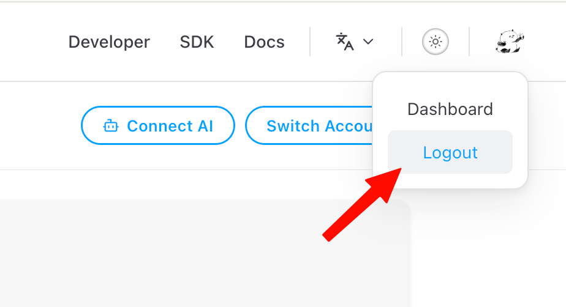

## Products and getting started {#getting-started}

### What is TQX? {#what-is-tqx}

TQX is PandaAI's international platform for AI-assisted quantitative research and trading. You can research factors, backtest strategies, test them in simulation accounts, and connect supported live brokerage accounts.

- **Qube** supports factor and strategy research, backtesting, and optimization.
- **Agent Factory** is being developed to support agent workflows. Availability and release details will be announced separately.

Visit the [TQX website](https://www.tqx.ai/en/) to get started.

### Who can use TQX? {#who-can-use-tqx}

TQX supports several workflows:

- **Research:** use Qube to create and evaluate factors and strategies.
- **Simulation:** use TQX CLI with a coding agent to test a strategy in a simulation account.
- **Trading:** use TQX CLI to query accounts and execute decisions through a `PAPER` or supported `LIVE` account.
- **Competition:** enter GATC with a supported live brokerage account and an original AI strategy executed through TQX CLI. Participants must be at least 18 and meet the applicable securities trading and competition eligibility requirements.

### How do I get started? {#quick-start}

<Steps>
  <Step title="Research and backtest">
    Create a factor or strategy in Qube, validate it, run an analysis or
    backtest, review the results, and save a version.
  </Step>
  <Step title="Verify with TQX CLI">
    [Install TQX CLI](/cli), sign in with an API key, connect a `PAPER` account,
    and test the strategy's execution. Read the run status and result before
    interpreting it.
  </Step>
  <Step title="Choose your next step">
    Continue with a general trading workflow or enter GATC after reviewing the
    requirements for each path below.
  </Step>
</Steps>

<Columns cols={2}>
  <Card title="Trade with TQX" icon="arrow-right-arrow-left" href="/trading/info">
    Use `tqx trading` with a `PAPER` or supported `LIVE` account. Set account
    permissions and risk limits before executing trading decisions.
  </Card>

  <Card title="Enter GATC" icon="trophy" href="/faq/gatc">
    Review the competition requirements, then connect a supported live brokerage
    account. Simulation results do not count toward competition rankings.
  </Card>
</Columns>

### Do I need separate accounts for research, simulation, and competition? {#accounts}

Your TQX login gives you access to Qube. Simulation accounts and live trading accounts are separate account types managed under that login. To enter GATC, link a supported live brokerage account.

## Tools and terminology {#terminology}

### What is a CLI? {#what-is-cli}

CLI stands for command-line interface. TQX CLI lets you or a coding agent sign in to TQX, use Qube research tools, and manage trading accounts from a terminal. See the [CLI guide](/cli).

### What is an AI agent? {#what-is-an-agent}

An AI agent can plan steps, call tools, evaluate results, and continue a task autonomously. A coding agent with terminal access, such as Codex, Claude Code, or Cursor, can use TQX CLI to connect research, backtesting, simulation, and live trading. You define the goals and permissions; the agent makes and executes decisions within that scope.

## Account setup {#account-setup}

### What if I selected the wrong broker on LongPort? {#wrong-broker-on-longport}

<Steps>
  <Step title="Sign out of LongPort">
    If TQX displays **Unsupported broker** after you selected a different broker on LongPort, open the [LongPort dashboard](https://open.longportapp.com/dashboard). Click your profile picture in the upper-right corner and select **Logout**.

    <Frame caption="Open the profile menu and select Logout">
      
    </Frame>

  </Step>
  <Step title="Link your account again">
    Then return to the [Panda account linking page](https://www.tqx.ai/en/user-center/longport?broker=panda) and start the linking process again.
  </Step>
</Steps>

## Related questions {#related-questions}

<Columns cols={2}>
  <Card title="Qube" icon="flask" href="/faq/qube">
    Research, data, and subscriptions.
  </Card>

  <Card title="GATC" icon="trophy" href="/faq/gatc">
    Registration, scoring, and prizes.
  </Card>
</Columns>

[Contact support](/more/contact-us)
