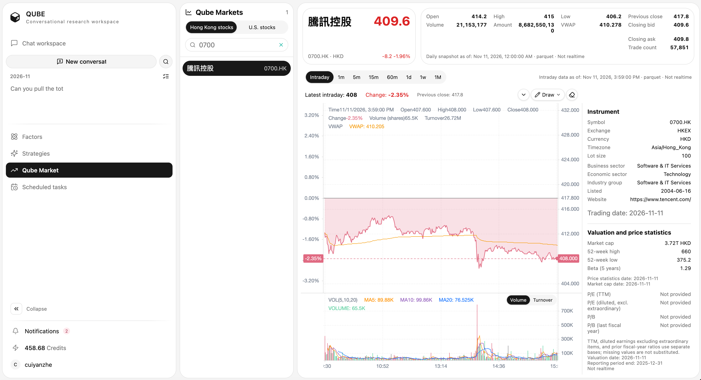

本頁適用於在 Qube 內執行的 Python 程式。原生 `tqx_data` Skill 從 Qube 研究快照提供歷史行情及參考數據，不需要 `tqx_data.init()` 或本機 API Key。

<Frame caption="Qube Market 顯示歷史行情快照">
  
</Frame>

在 Qube 中開啟 [Qube Market](https://www.tqx.ai/qube/market)，選擇港股或美股，再搜尋標的。你可以切換圖表週期、查看標的資料和快照時間。解讀畫面上的價格前，先確認 **Not realtime**（非即時）標籤。

<Info>
  Qube 透過原生執行環境提供歷史數據。你可以從 [數據總覽](/hk/data/info) 尋找 API，再確認其參考頁標示的支援環境。
</Info>

<Tabs>
  <Tab title="Qube 沙箱">
    使用 Qube 內建的 `tqx_data` 模組。從 [數據總覽](/hk/data/info) 找到所需 API 後，請在其參考頁確認是否支援 Qube，以及可用的參數與欄位。
  </Tab>
  <Tab title="策略回測">
    策略程式碼使用獨立的執行環境介面。請參閱 [編寫策略](/hk/qube/research/strategy/code)，了解 Bars、歷史數據和重播行為。
  </Tab>
</Tabs>

## 沙箱與策略回測

兩者都是 Qube 的執行環境，但負責的工作不同：

| 環境 | 用途 | 程式介面 | 常見結果 |
| --- | --- | --- | --- |
| Qube 沙箱 | 執行對話、Skill、工作區任務，以及探索性的 Python 程式 | 工作區檔案和原生 `tqx_data` 方法 | 檔案、圖表、數據查詢和程式草稿 |
| 策略回測 | 使用市場專用回測引擎，對 <Tooltip tip="Bar 是一段時間的行情摘要，像圖表上的一根 K 線，通常包含開市價、最高價、最低價、收市價及成交量。日線 Bar 代表一個交易日，分鐘 Bar 代表一分鐘；回測會按時間順序重播這些歷史資料。" headline="歷史 Bar">歷史 Bar</Tooltip> 執行已保存的策略 | `panda_backtest`、`initialize`、`handle_data`、Bar 和重播回呼 | 權益、交易、成本、日誌和回測結果 |

你可以把沙箱理解為 Qube 的通用代理和工作區執行環境。提交策略回測後，程式會按照另一套更嚴格的策略執行規約，在策略回測引擎中運行。在沙箱中可用的程式碼，不一定能直接放進策略；提交回測前請先閱讀 [編寫策略](/hk/qube/research/strategy/code)。
