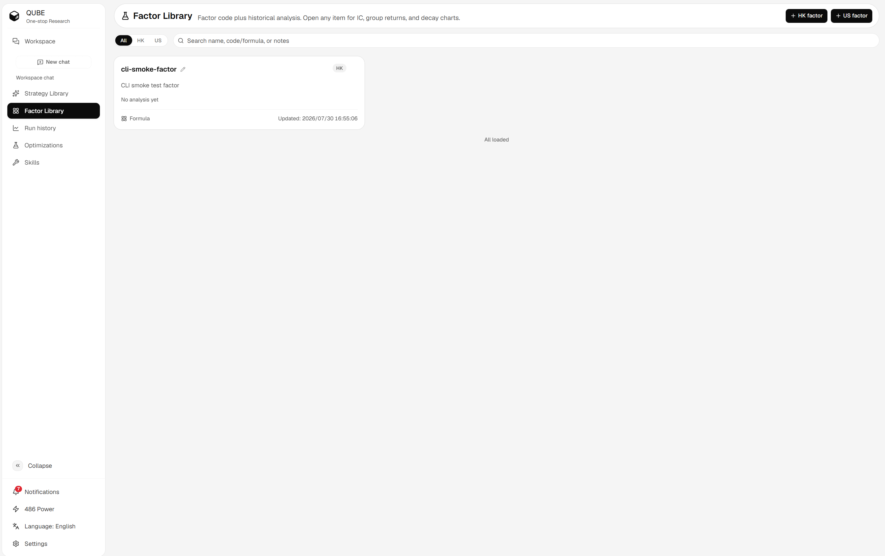

想像你要比較很多股票，先問一個簡單問題：哪些公司的表現比其他公司改善得快？因子會把這個問題變成每個日期、每隻股票都能重複計算的分數。之後你可以檢查高分股票在未來是否真的有不同表現。

在 Qube 中，因子是將行情或財務輸入轉換成數值訊號的研究物件，訊號按日期和股票排列。你可以在 Qube 撰寫訊號、分析它與後續報酬的關係、保存命名版本，並在考慮放入策略前調優有限的參數。

## Qube 因子的組成

| 物件 | 內容 |
| --- | --- |
| 因子 | ObjectId、固定市場、`title`、`description`、目前原始碼及分析設定。 |
| 原始碼修訂 | 目前的公式或 Python 程式，與設定修訂分開追蹤。 |
| 分析執行 | 單次執行固定的原始碼、設定、期間、狀態及結果。 |
| 命名版本 | 從成功的一般分析明確建立的不可變快照。 |
| 調優 | 比較有限的分析設定或程式數值參數。 |

## 使用因子

1. 為 `hk` 或 `us` [建立因子](/hk/qube/research/factor/create)。
2. [撰寫訊號](/hk/qube/research/factor/code)，並確認 [算子行為](/hk/qube/research/factor/operator-reference)。
3. [儲存設定並執行分析](/hk/qube/research/factor/analyze)。
4. [閱讀結果](/hk/qube/research/factor/results)，包括分組報酬及 IC 穩定性。
5. [建立命名版本](/hk/qube/research/factor/versions)，或 [進行參數調優](/hk/qube/research/factor/optimization)。
6. 明確定義交易規則後，再 [將版本用於策略](/hk/qube/research/strategy/factor-to-strategy)。

因子分析不會模擬完整交易策略。你可以透過 [因子 API](/hk/qube/api/factors) 頁面中的 CLI 或 SDK，自動化同一流程。

<Frame caption="因子庫的市場篩選、搜尋和新增因子入口">
  
</Frame>
