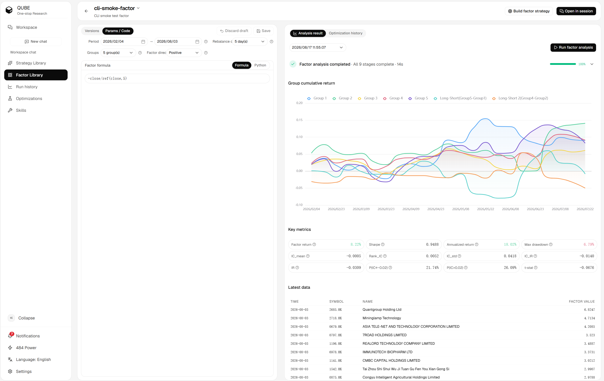

分析會在指定期間評估因子已儲存的訊號。提交執行前，先儲存有效的原始碼及設定。

## 設定分析

| 設定 | 支援值 |
| --- | --- |
| 期間 | 開始日須早於結束日；最多五個曆年，包含剛好五年的邊界。 |
| 分組數 | `3`、`5`、`10` 或 `20`。 |
| 調倉週期 | `1`、`3`、`5`、`10`、`20` 或 `30` 個交易日。 |
| 方向 | `1`（正向）或 `-1`（負向）。 |

使用資產所屬的港股或美股市場。TQX 股票流程不要傳入股票／期貨選擇器或自訂 `stock_pool`。

## 提交及追蹤

1. 開啟因子詳情，審閱已儲存的原始碼及分析設定。
2. 解決原始碼或設定的驗證錯誤，先套用或捨棄尚未處理的參數草稿。
3. 提交分析。Qube 會固定該次原始碼、設定、市場及期間。
4. 追蹤 `preparing`、`queued`、`running`，直到 `succeeded`、`failed` 或 `cancelled`。
5. 開啟該次執行的 [結果](/hk/qube/research/factor/results)。後續修改目前因子不會改寫它。

CLI 與 SDK 啟動執行時須提供兩個預期修訂號。[因子 API](/hk/qube/api/factors) 提供可操作的範例。請求受理不代表分析成功。

停止操作會請求取消；須讀取最終狀態後才能確認執行已結束。本機輪詢逾時不會停止遠端分析。

<Frame caption="因子詳情頁的分析參數、程式碼編輯器和結果歷史">
  
</Frame>
