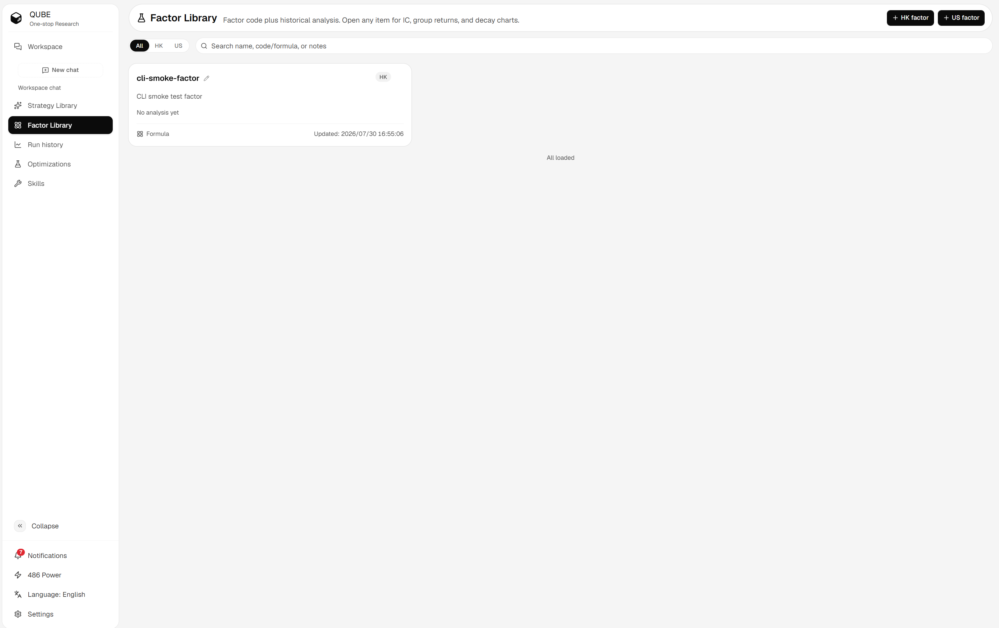

你可以在對話或因子庫建立因子。選擇港股（`hk`）或美股（`us`），填寫 `title`、選填 `description`，並選擇公式或 Python 原始碼。市場及原始碼類型決定執行規約。

## 描述假說

使用具體的要求，例如：

```text
建立港股因子，計算收市價的 5 日移動平均減去 20 日移動平均。使用 Python，兩個視窗都放在數值型 FACTOR_PARAMS 中。儲存因子、解釋歷史資料不足時的行為，暫時不要執行分析。
```

在因子詳情頁審閱原始碼。你可以儲存未完成的程式供後續編輯；驗證結果須另外檢查。儲存資產不等於執行分析，也不等於建立命名版本。

## 從已儲存資產繼續

保留回傳的因子 ID。儲存分析日期、分組數、調倉週期及方向，待目前原始碼與設定有效後再提交分析。詳見 [分析因子](/hk/qube/research/factor/analyze)。

本機自動化可使用 [CLI](/hk/qube/api/factors) 的 `--formula` 或 Python `--file` 建立因子。你可以透過搜尋及市場篩選找回同一資產。

<Frame caption="在因子庫建立和瀏覽因子">
  
</Frame>
