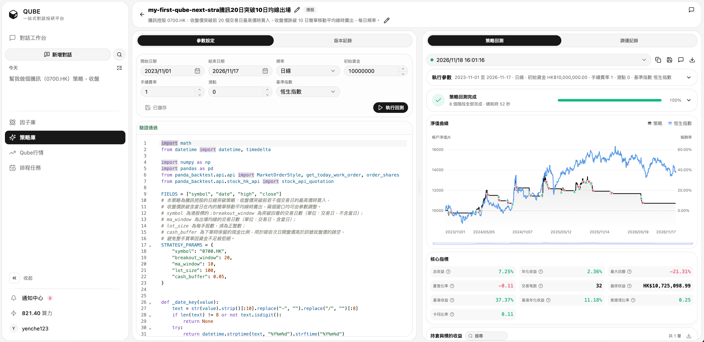
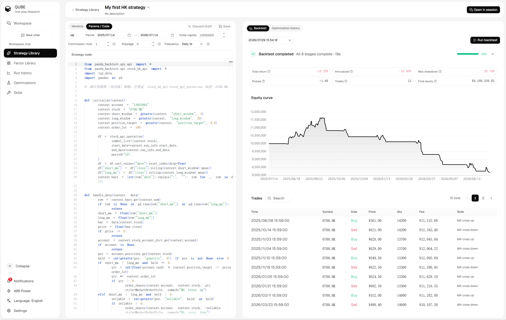

回測是在問：「如果過去一直按這些規則買賣，模擬資金會怎樣變化？」它使用歷史價格，以及你設定的成交與成本假設，不會送出真實訂單。

## 選擇回測設定

開啟已儲存的策略，先檢查回測設定。以下騰訊例子的截圖使用日線數據，日期為 2023 年 11 月 1 日至 2026 年 11 月 17 日。

| 設定           | 代表什麼                                 | 要核對什麼                                                    |
| -------------- | ---------------------------------------- | ------------------------------------------------------------- |
| 開始及結束日期 | 模擬的歷史期間。                         | 在可行情況下，涵蓋上升及下跌行情。                            |
| 頻率           | 模擬多久處理一次數據，例如日線或分鐘線。 | 配合規則；每天判斷一次的策略可先用日線理解。                  |
| 初始資金       | 模擬開始時可用的金額。                   | 必須大於零。截圖使用港幣 1,000 萬元，只是例子，不是入金要求。 |
| 手續費         | 引擎納入計算的交易成本。                 | 請 Qube 說明成本假設；引擎的佣金倍數不等於百分比費率。        |
| 滑點           | 參考價與模擬成交價之間假設的差距。       | 設為零即假設沒有這種價差，結果可能較樂觀。                    |
| 基準指數       | 用來比較的市場指數。                     | 選擇同市場的指數，並在同一日期範圍比較。                      |

港股預設以恒生指數為基準，也可選恒生中國企業指數或恒生科技指數。美股預設為標普 500，也支援納斯達克綜合指數、納斯達克 100 及道瓊斯指數。

日線回測最長支援 10 年，分鐘線最長一年。請 Qube 核對所需數據是否涵蓋選定期間。

## 儲存並執行

先儲存設定，確認策略與設定通過驗證，再按**執行回測**，或請 Qube 執行已儲存的策略。第一次回測前不需要先建立命名版本。

每次執行會保留啟動時的程式碼及設定，之後修改工作稿不會改寫該次結果。準備中、排隊中或執行中，圖表可能仍為空或尚未完整，應等完成後再解讀。

<Frame caption="左邊是已儲存的設定，右邊是完成的回測與基準比較。">
  
</Frame>

## 讀懂這次示例結果

先看右邊圖表。黑線是策略的模擬帳戶淨值，藍線是恒生指數基準；圖上的標記代表模擬買入及賣出。

截圖中，策略約上升 **7.25%**，基準約上升 **37.37%**。策略在模擬中賺了錢，但落後基準。只有正收益，並不足以說明策略帶來額外價值。

接著一起看以下數字：

- **總收益：** 整段測試期間的變化。例如港幣 100,000 元增至 107,250 元，就是 7.25% 收益。
- **年化收益：** 把整段結果換算成等效的每年增長率，不代表每個年份都賺同一比例。
- **最大回撤：** 帳戶從先前高點往下跌的最大百分比。例子約為 21.31%；最後賺錢，途中仍可能承受很大跌幅。
- **交易次數及成本：** 查看交易有多頻繁，成本如何影響結果。再打開幾筆交易，檢查時機是否符合規則。

這些數字用來示範如何閱讀頁面，不能預測未來結果。

## 改規則前先找原因

請 Qube 解釋最大虧損在何時發生、個別交易為什麼出現，以及缺失價格或遭拒訂單是否影響結果。如果執行失敗，先查看錯誤；如果仍在執行，應回到同一次紀錄，而不是重複啟動。

想公平比較改動，應保持日期、初始資金、費用及基準一致。一般回測成功後，Agent 可以建立[命名版本](/hk/qube/research/strategy/versions)，或用[參數調優](/hk/qube/research/strategy/optimization)比較設定。

<Accordion title="並排查看程式碼與結果">
  詳情頁也能並排顯示程式碼、參數及結果。你可以請 Qube 解釋相關程式；Agent 可以驗證買賣規則，不需要你先讀懂每一行。

  <Frame caption="策略詳情頁把設定、程式碼、結果及交易連在一起。">
    
  </Frame>
</Accordion>

<Accordion title="透過 CLI 或 SDK 執行回測">
  先儲存及驗證設定，再以核對過的原始碼及設定修訂號提交一般執行，不帶臨時覆寫。臨時覆寫不會更新已儲存設定。

執行中的結果可能不完整。缺少基準不代表零收益，本機等待逾時也不會取消遠端執行。詳細設定、修訂檢查、結果欄位、圖表可用狀態及報告下載方式，見[策略 API](/hk/qube/api/strategies)。

</Accordion>
