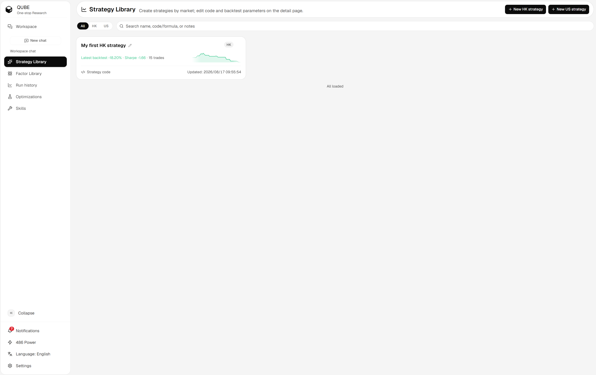

從對話或策略庫建立策略。選擇固定市場，提供 `title`、選填 `description`，以及 Python 原始碼。

## 描述可執行規則

寫清楚股票範圍、訊號時間、進出場、倉位大小、可用資金、成本及風險上限。區分觀測數據的時間與成交時間，並要求 Qube 解釋自行補上的假設。

分別審閱及儲存原始碼與回測設定。無效原始碼可以儲存為草稿，但不能啟動有效執行。儲存不會提交回測或建立命名版本。

## 選擇數據及選填綁定

使用市場專屬引擎 API 取得歷史及 Bars。如需因子驅動策略，明確綁定同市場、可執行的因子命名版本；不要把未審閱的目前因子草稿默默作為輸入。

接著閱讀 [策略程式碼](/hk/qube/research/strategy/code) 及 [回測與結果](/hk/qube/research/strategy/backtest)。外部自動化可使用 [策略 API](/hk/qube/api/strategies)。

<Frame caption="策略庫中的市場篩選、搜尋和新增策略入口">
  
</Frame>
