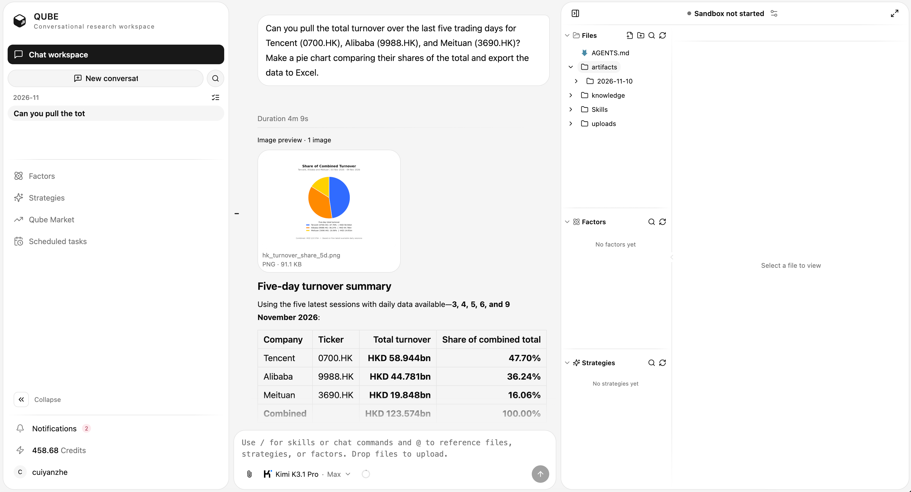

工作區檔案可存放筆記本、數據摘錄、提示詞、報告及產出物。這些檔案保留在雲端工作區，與 Qube 正式研究資產分開。沙箱的簡單說明請參閱 [工作區與沙箱](/hk/qube/workspace)。

<Frame caption="Qube 對話旁的工作區檔案面板">
  
</Frame>

在對話中開啟側邊面板，即可在 **Files** 瀏覽沙箱檔案。**Factors** 和 **Strategies** 區域則分別列出正式的因子和策略資產。

使用 `knowledge/` 儲存個人知識，`artifacts/` 儲存產出物，`uploads/` 儲存上傳檔案。重複的上傳檔名會自動加上後綴。

檔案可以提供給對話或程式碼審閱參考，但不會自動成為因子、策略、版本或執行。請透過研究流程儲存正式物件。
