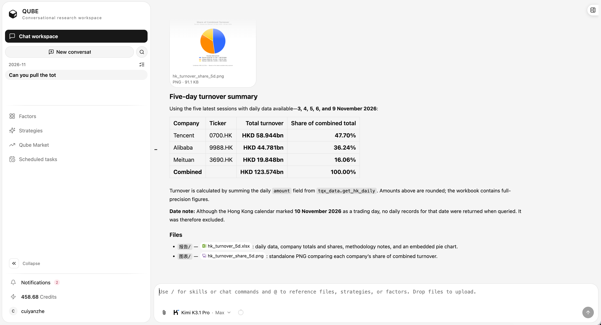

A Qube conversation is the working context where you ask questions, inspect files, and ask the agent to create or revise research assets. Conversation history is separate from the formal Factor and Strategy records, but a reply can operate on those records when you explicitly ask it to.

<Frame caption="Conversation with a generated chart and research files">
  
</Frame>

## Keep context intentional

- Use `@` to reference a file, folder, factor, or strategy in the current workspace.
- Use Skills to give the agent the relevant data or authoring contract.
- When you send a message, Qube snapshots the selected asset context. An unsaved file draft is not included until you save it.
- Clone a conversation when you need an independent line of investigation.
- Stop or edit a queued message when the request needs correction.

Conversation output is a proposal or working result until you review and save the appropriate source, configuration, version, or report.
