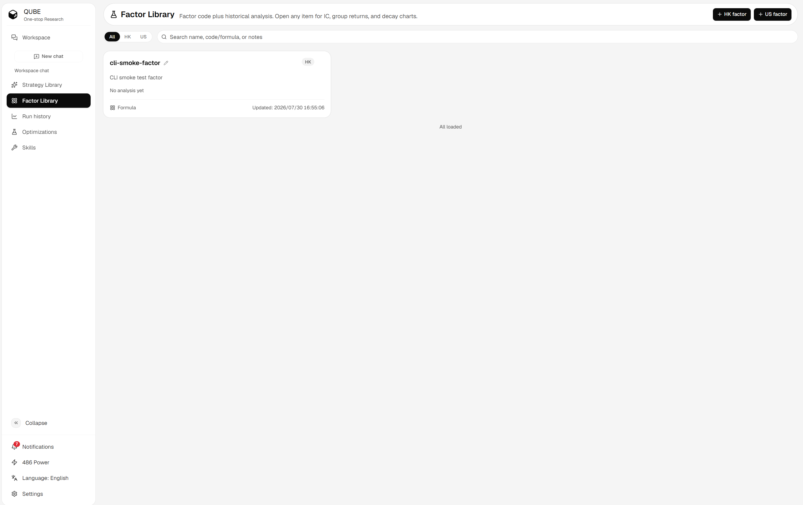

Imagine you want to compare many stocks using one simple question: which companies have been growing faster than others? A factor turns that question into a repeatable score for each stock on each date. You can then check whether stocks with higher scores actually performed differently later.

In Qube, a factor is a research object that converts market or financial inputs into a numeric signal indexed by date and symbol. Qube lets you write the signal, analyze its relationship with future returns, save a named version, and tune bounded parameters before you consider using it in a strategy.

## Parts of a Qube factor

| Object | Contents |
| --- | --- |
| Factor | An ObjectId, fixed market, `title`, `description`, current source and analysis configuration. |
| Source revision | The current formula or Python code, tracked separately from configuration. |
| Analysis run | Frozen source, configuration, period, status, and results for one execution. |
| Named version | Immutable snapshot created explicitly from a successful ordinary analysis. |
| Tuning | A bounded comparison of analysis settings or numeric code parameters. |

## Work with a factor

1. [Create a factor](/qube/research/factor/create) for `hk` or `us`.
2. [Write the signal](/qube/research/factor/code) and check [operator behavior](/qube/research/factor/operator-reference).
3. [Save configuration and run an analysis](/qube/research/factor/analyze).
4. [Read results](/qube/research/factor/results), including group returns and IC stability.
5. [Create a named version](/qube/research/factor/versions) or [tune parameters](/qube/research/factor/optimization).
6. Define explicit trading rules before [using a version in a strategy](/qube/research/strategy/factor-to-strategy).

Factor analysis does not simulate a complete trading strategy. Use the CLI or SDK in the [Factor API](/qube/api/factors) to automate the same lifecycle.

<Frame caption="Factor Library with market filters, search, and new factor actions">
  
</Frame>
