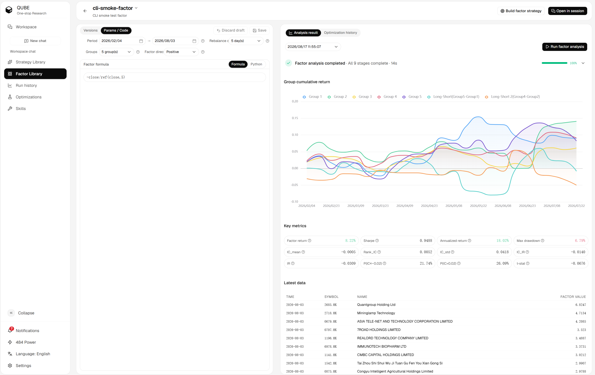

An analysis evaluates the factor's saved signal over a defined period. Save valid source and configuration before submitting a run.

## Set the configuration

| Setting | Supported values |
| --- | --- |
| Period | Start before end; at most five calendar years, including the exact five-year boundary. |
| Groups | `3`, `5`, `10`, or `20`. |
| Adjustment cycle | `1`, `3`, `5`, `10`, `20`, or `30` trading days. |
| Direction | `1` (positive) or `-1` (negative). |

Use the asset's Hong Kong or US market. Do not pass stock/futures selectors or a custom `stock_pool` to the TQX equity workflow.

## Submit and monitor

1. Open the factor detail page and review saved source and analysis settings.
2. Resolve source or configuration validation errors. Apply or discard any pending parameter draft first.
3. Submit the analysis. Qube freezes the exact source, configuration, market, and period with the run.
4. Track `preparing`, `queued`, and `running` until `succeeded`, `failed`, or `cancelled`.
5. Open that run's [results](/qube/research/factor/results). Changes to the current factor never rewrite it.

The CLI and SDK require both expected revisions when starting a run. See [Factor API](/qube/api/factors) for an executable example. Request acceptance is not evidence of successful analysis.

Stopping requests cancellation; read the final state before assuming execution has ended. A local polling timeout leaves the remote analysis running.

<Frame caption="Factor detail page with analysis parameters, code editor, and result history">
  
</Frame>
