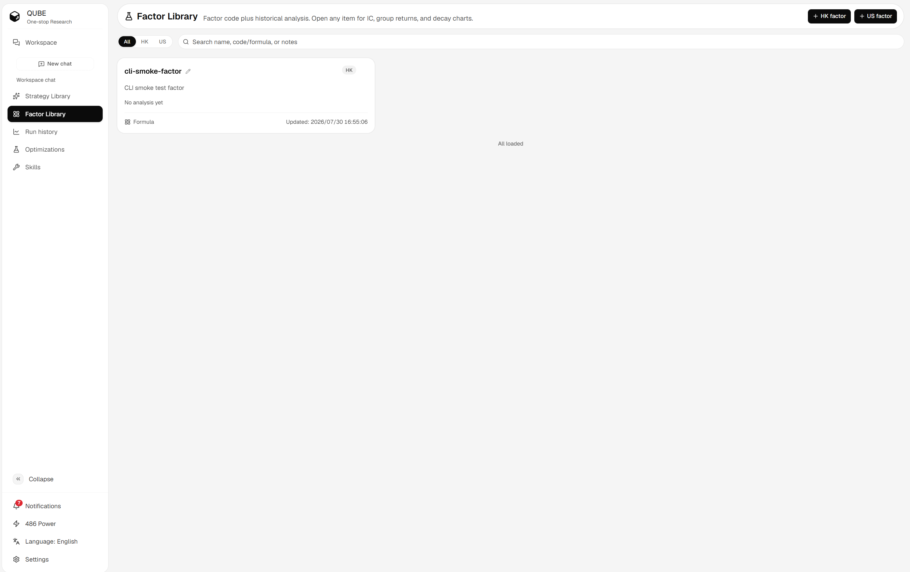

Create a factor from a conversation or the Factor Library. Choose Hong Kong (`hk`) or US (`us`), supply a `title` and optional `description`, and choose formula or Python source. The market and source type determine the runtime contract.

## Describe the hypothesis

Use a concrete request such as:

```text
Create a Hong Kong equity factor using the 5-day moving average of close minus the 20-day moving average. Use Python with numeric FACTOR_PARAMS for both windows. Save the factor, explain its missing-history behavior, and do not run an analysis yet.
```

Review the source in the factor detail page. You can save an unfinished source for further editing; check its validation result separately. A saved asset is not an executed analysis or a named version.

## Continue from the saved asset

Keep the returned factor ID. Save analysis dates, group count, adjustment cycle, and direction, then submit an analysis when the current source and configuration are valid. See [Analyze a factor](/qube/research/factor/analyze).

For local automation, [create with the CLI](/qube/api/factors) using `--formula` or a Python `--file`. Library search and market filters help you return to the same asset later.

<Frame caption="Create and browse factors in the Factor Library">
  
</Frame>
