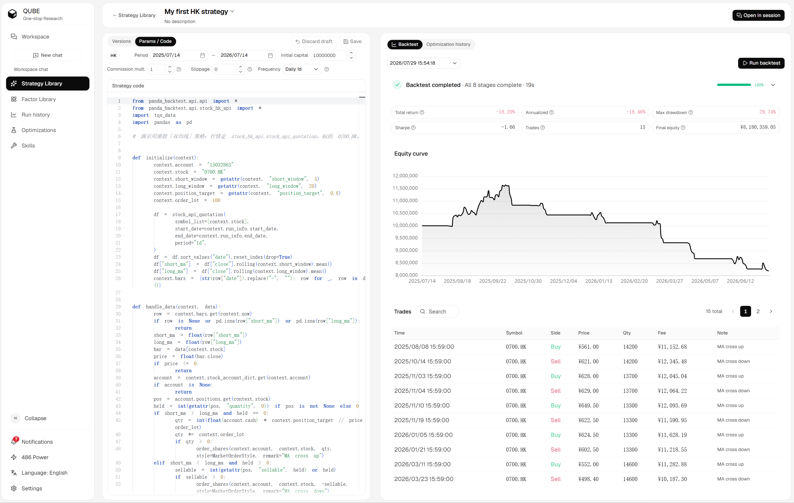

A backtest executes a frozen snapshot of valid source and saved configuration. You do not need a named version before starting an ordinary run.

## Configure the simulation

| Field | Meaning |
| --- | --- |
| `period_start`, `period_end` | Ordered dates; same-day runs allowed. Daily intervals allow at most 10 years; minute intervals at most 1 year. |
| `frequency` | `1d` for daily or `1M` for minute replay. |
| `init_balance` | Positive initial capital. |
| `commission_rate` | Nonnegative engine commission multiplier; CLI and SDK pass it unchanged. |
| `slippage` | Proportional slippage, not a cash amount or number of ticks. |

Hong Kong and US configuration does not support `standard_symbol` or `margin_rate`. Review source validation, configuration validation, and any same-market factor version binding. Resolve pending parameter drafts before running.

## Execute and interpret

Submit the current source and configuration revisions. Track `preparing`, `queued`, and `running` until a terminal state. After `succeeded`, review:

- **Equity and metrics:** returns, drawdown, volatility, period, and assumptions.
- **Trades:** entries, exits, quantities, fill prices, costs, and missed/rejected activity.
- **Symbol performance and account summary:** concentration and contribution.
- **Logs:** runtime behavior, missing data, and errors.

Use the [CLI](/qube/api/strategies) to download the report or page through result fields; use the [SDK](/qube/api/strategies) for result pages, charts, and symbol K-lines. A polling timeout does not cancel the remote run.

Create a [named version](/qube/research/strategy/versions) only after reviewing a successful ordinary backtest. Historical performance cannot guarantee future results.

<Frame caption="Strategy detail page with parameters, code, and backtest results">
  
</Frame>
