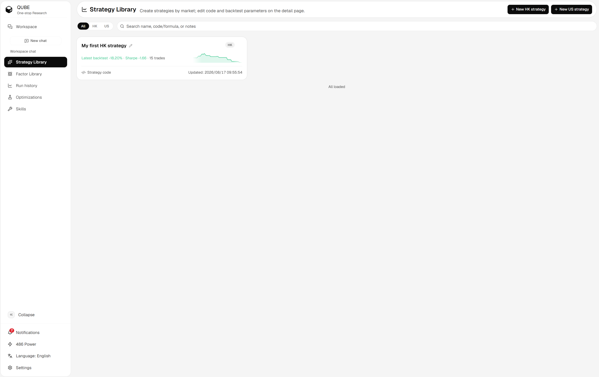

Create from a conversation or the Strategy Library. Choose a fixed market, provide a `title`, optional `description`, and Python source.

## Describe executable rules

Specify the universe, signal timing, entries, exits, sizing, available cash, costs, and risk limits. Distinguish data observation time from order execution time. Ask Qube to explain any assumptions it adds.

Review and save the source and backtest configuration separately. Invalid source may be saved as a draft but cannot start a valid run. Saving does not submit a backtest or create a named version.

## Choose data and optional binding

Use market-specific engine APIs for history and Bars. If you request a factor-driven strategy, bind an explicit same-market executable named factor version; do not let an unreviewed current factor draft silently become its input.

Continue with [Strategy code](/qube/research/strategy/code) and [Backtest and results](/qube/research/strategy/backtest). For external automation use [Strategy API](/qube/api/strategies).

<Frame caption="Strategy Library with market filters, search, and new strategy actions">
  
</Frame>
