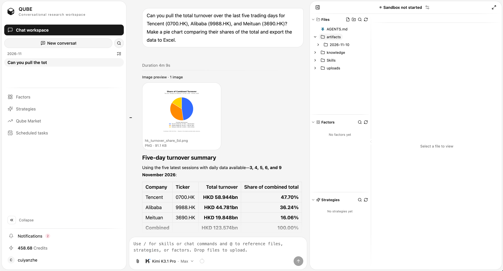

Workspace files hold notebooks, data extracts, prompts, reports, and generated artifacts. These files persist in your cloud workspace and are separate from formal Qube research assets. See [workspace and sandbox](/qube/workspace) for a short introduction to the environment.

<Frame caption="Workspace files available beside a Qube conversation">
  
</Frame>

Open the side panel in a conversation to browse sandbox files under **Files**. The **Factors** and **Strategies** sections list formal research assets separately.

Use `knowledge/` for personal knowledge, `artifacts/` for generated outputs, and `uploads/` for uploaded files. Duplicate upload names receive a suffix.

A file can inform a conversation or source review, but it does not become a Factor, Strategy, Version, or Run automatically. Save the formal object through its research workflow.
